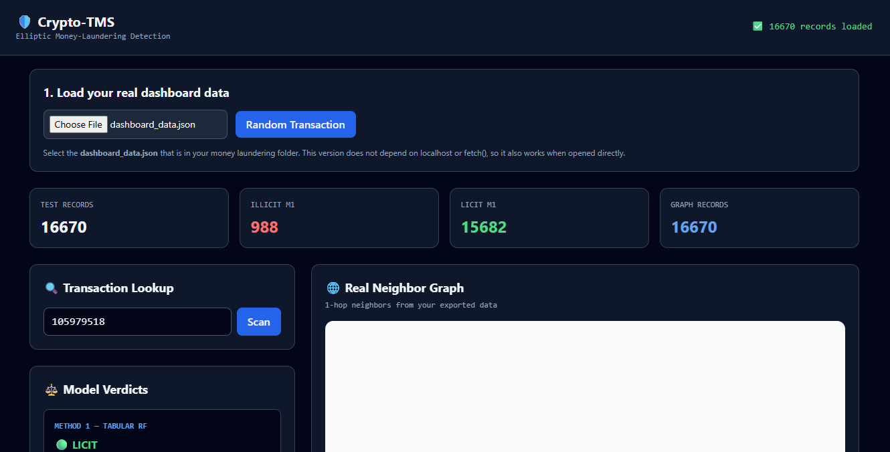

# Crypto-TMS — Money-Laundering Detection on a Transaction Graph

## Group 6

Crypto-TMS is a compliance/forensics dashboard built around the Elliptic Bitcoin transaction dataset. The project compares:

1. **Method 1 — Tabular Random Forest:** transaction-level features only.
2. **Method 2 — Graph-Feature Random Forest:** transaction features plus hand-built graph features.
3. **Optional GCN:** not required for the core submission.

The dashboard is a demonstration interface for inspecting real precomputed test-set predictions and transaction-network structure.


*Live view: 16,670 real test-set transactions loaded, with per-model verdicts, transaction lookup, and a 1-hop neighbor graph.*

---

## Results at a glance

| Method | Illicit Precision | Illicit Recall | Illicit F1 |
|---|---:|---:|---:|
| Tabular RF | 0.8026 | 0.7322 | 0.7658 |
| Graph-Feature RF (as run, 4 graph features) | **0.8731** | 0.7304 | **0.7954** |
| Ablation: Graph RF without `neighbor_illicit_frac` (degree, out-degree, PageRank only) | 0.76 | 0.73 | 0.74 |

Split by time period (computed from the exported predictions):

| Test period | Illicit in test | Model | Precision | Recall | F1 |
|---|---:|---|---:|---:|---:|
| Steps 35–42 | 914 | Tabular RF | 0.894 | 0.864 | 0.879 |
| Steps 35–42 | 914 | Graph-Feature RF | 0.937 | 0.862 | 0.898 |
| Steps 43–49 | 169 | Tabular RF | 0.029 | 0.018 | 0.022 |
| Steps 43–49 | 169 | Graph-Feature RF | 0.046 | 0.018 | 0.026 |

**Key takeaways**
- As run, the graph-feature model improves illicit precision and F1, **but the gain comes from `neighbor_illicit_frac`, which is exactly zero for all 16,670 test transactions (verified).** Without it, precision is 0.76 and F1 0.74, slightly below the tabular baseline. We therefore do not claim that graph structure improved detection (see Limitations).
- Both models detect about 86% of illicit transactions until step 42, then fail almost completely after the step-43 distribution shift.
- The overall recall of about 0.73 is an average of these two regimes.

---

## 1. Dataset

The project uses the Elliptic Bitcoin transaction dataset.

- Transaction nodes: **203,769**
- Graph edges: **234,355**
- Training transactions: **29,894**
- Test transactions: **16,670**
- Test labels:
  - Licit: **15,587**
  - Illicit: **1,083**

Because the task is temporal, the project uses a temporal split rather than a random split:

- **Training:** time steps 1–34
- **Testing:** time steps 35–49

This prevents future transactions from being randomly mixed into the training data.

---

## 2. Machine-Learning Methods

### Method 1 — Tabular Random Forest

Uses the original transaction-level features.

### Method 2 — Graph-Feature Random Forest

Adds structural information from the transaction graph:

- In-degree
- Out-degree
- PageRank
- Neighborhood illicit fraction (computed from training-period labels only, to avoid label leakage; **zero for all test transactions**, see Main finding)

### Main finding

As run, adding the four graph features improved illicit precision from **80.26% to 87.31%** and illicit F1 from **76.58% to 79.54%**, with overall recall unchanged at about 73%.

**Important caveat (verified by a feature check and an ablation):** `neighbor_illicit_frac` uses only training-period labels, and Elliptic edges connect transactions within the same time step, so the feature is zero for every test transaction. It is non-zero for some training transactions, so the forest learns to use it, and at test time it never fires. This train/test mismatch most likely makes the model more conservative and raises precision. Removing the feature (keeping in-degree, out-degree and PageRank) gives precision 0.76, recall 0.73, F1 0.74 (single run, seed 42), slightly below the tabular baseline. So the reported gain is not evidence that graph structure helps; it is an artifact we found and report.

### Reading the F1-over-time chart (`f1_over_time.png`)

Illicit F1 is high through time step 42 and then falls to near zero from step 43 onward for both methods. **This is a genuine temporal distribution shift, not only a small-sample artifact.**

| Time step | 40 | 41 | 42 | 43 | 44 | 45 | 46 | 47 | 48 | 49 |
|---|---:|---:|---:|---:|---:|---:|---:|---:|---:|---:|
| Illicit count | 112 | 116 | 239 | 24 | 24 | 5 | 2 | 22 | 36 | 56 |

Individual late steps have few illicit examples, so per-step F1 is noisy. But pooled over steps 43–49 there are 169 illicit transactions, and both models recall only about 1.8% of them. Models trained on steps 1–34 do not generalize to the later period (consistent with the known step-43 shift in the Elliptic data). The aggregate recall of about 0.73 is an average of about 0.86 before step 43 and about 0.02 after it.

---

# 3. How to Run the Dashboard — IMPORTANT

## Option B: Standalone Dashboard

The standalone dashboard works without Live Server and without the browser fetching a local JSON file automatically. An internet connection is needed because the page loads Tailwind and vis-network from a CDN.

### Files that must be together

```
Crypto-TMS-dashboard.html
dashboard_data.json
```

### Step 1 — Open the dashboard
Double-click `Crypto-TMS-dashboard.html`. It opens in a browser.

### Step 2 — Load the real project data
Click **Choose File** and select `dashboard_data.json` from the project folder. The dashboard should show `16670 records loaded` and populate the summary cards.

### Step 3 — Select a transaction
- **Random Transaction:** click the button to pick one test transaction automatically.
- **Transaction Lookup:** enter a transaction ID and click **Scan**. The transaction must exist in the exported test-set records.

### Step 4 — Inspect the model verdicts
The dashboard displays the Method 1 verdict, the Method 2 verdict, the ground-truth test label, and the illicit probability for each model.

### Step 5 — Inspect graph information
The dashboard displays time step, in-degree, out-degree, PageRank, and one-hop transaction neighbors (up to 5 incoming and 5 outgoing are exported).

---

# 4. Important Dashboard Interpretation

The dashboard is a **forensic demonstration interface**, not an autonomous financial decision system.

The model predictions are **precomputed** in the notebook and exported into `dashboard_data.json`. The dashboard does not retrain the models in the browser.

```
Notebook → Train models → Generate test predictions → Export dashboard_data.json
→ Dashboard loads the exported results → User investigates transactions
```

---

# 5. How to Demonstrate the Project (2–3 minutes)

1. Open `Crypto-TMS-dashboard.html`.
2. Click **Choose File**, select `dashboard_data.json`, and confirm `16670 records loaded`.
3. Click **Random Transaction**.
4. Show the transaction ID, Tabular RF prediction, Graph-Feature RF prediction, and ground truth.
5. Show the graph statistics: degree, PageRank, time step.
6. Explain the comparison:

> The tabular model uses transaction features only. The graph-enhanced model, as run, raised illicit precision from 0.803 to 0.873 and F1 from 0.766 to 0.795. But we checked and found the neighborhood feature is zero for every test transaction, and an ablation without it gives precision 0.76, below the baseline, so the gain is an artifact and not proof that graph structure helps. Both models also work well until step 42 (recall about 0.86) but fail after the step-43 distribution shift (recall about 0.02).

---

# 6. How to Reproduce the Machine-Learning Experiment

Open `elliptic_money_laundering_detection.ipynb` and run the cells in order.

```
Load Elliptic data → Clean and align transactions → Temporal train/test split
→ Train Tabular Random Forest → Build transaction graph → Compute graph features
→ Train Graph-Feature Random Forest → Evaluate precision / recall / F1
→ Evaluate F1 over time → Export dashboard predictions
```

---

# 7. Why Temporal Evaluation Matters

Random splitting would let later transactions appear in training while earlier ones appear in testing, giving unrealistically optimistic estimates. A temporal split better represents deployment:

```
Past transactions → training
Future transactions → testing
```

The step-43 collapse above is exactly the kind of failure a random split would hide.

---

# 8. Evaluation

The test set is imbalanced (Licit: 15,587, Illicit: 1,083), so accuracy alone is not sufficient. The key metrics are illicit precision, recall, and F1 (see the results table above).

---

# 9. Project Limitations

- The illicit class is substantially smaller than the licit class.
- **Severe temporal distribution shift after step 43:** both models detect almost no illicit transactions in steps 43–49 (recall about 0.02 on 169 illicit transactions). Retraining or domain adaptation would be needed for deployment.
- The neighborhood-illicit-fraction feature is zero for all 16,670 test transactions (verified), so the precision gain (0.803 to 0.873) is most likely a train/test-mismatch artifact. An ablation without it gives precision 0.76 and F1 0.74, below the tabular baseline. A fair evaluation would compute neighborhood features without labels (e.g., aggregating neighbors' transaction features) or use a GCN.
- Results come from a single run with a fixed random seed (42); variance across seeds is not reported.
- Graph features are hand-engineered rather than learned end-to-end.
- The dashboard uses precomputed predictions rather than live model inference.
- The system is a research/educational prototype and not a production AML decision system.
- A GCN is an optional extension and is not part of the core two-model comparison.

---

# 10. Recommended Submission Files

```
Crypto-TMS/
├── elliptic_money_laundering_detection.ipynb
├── Crypto-TMS-dashboard.html
├── dashboard_data.json
├── comparison.csv
├── f1_over_time.png
├── Crypto-TMS_Final_Report.docx
└── README.md
```

---

## Final conclusion

As run, the graph-feature Random Forest improved illicit precision and F1 over the tabular baseline with recall roughly unchanged. However, the improvement depends on a neighborhood-label feature that is zero at test time; without it, degree and PageRank alone give no gain (precision 0.76, F1 0.74). Both models perform well through time step 42 but fail after the step-43 distribution shift. The project shows why temporal evaluation matters and why engineered features must be checked for consistency between training and test data.
